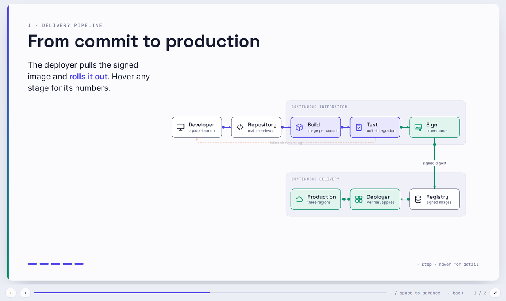

# trazo

*Architecture figures and slide decks as single HTML files, for people and their coding agents.*

Trazo is an agent skill for Claude Code and GitHub Copilot, installed as `html-diagrams-decks`, and a small JavaScript library for architecture figures and slide decks as single HTML files. Figures have stepped builds with captions, packets that flow along routed connectors, hover details, light and dark themes and a 50-icon sprite, and every figure on a page can be checked for overlapping and overflowing text before it is published.

- **EdgeDiagram** draws graphs: zones, nodes and orthogonal links that line up, go around boxes and fan out from one point, revealed step by step.
- **EdgeSequence** draws sequence diagrams: actors, numbered messages and replies, activation bars, notes and `alt`/`loop` frames, one message per step with a packet travelling along it.
- **EdgeSketch** draws figures laid out by hand on a grid, such as layered stacks and left-to-right platform views. Its boxes fit their text, and its check works on any SVG.
- **EdgeDeck** runs 1600×900 slide decks with per-slide steps, speaker's notes in a presenter view on a second screen, and a PDF of one 16:9 page per slide.
- **Three themes** share one token contract, each in light and dark, with a contrast checker, and **any DESIGN.md** (a brand's colours and faces) becomes a fourth with one command.



*The example deck, `examples/ci-canary-deck.html`, at the last step of its first slide. Each step adds a part of the pipeline; hover any stage for its numbers.*

No build step and no dependencies beyond Python 3 for the tools, a headless Chromium for screenshots and checks, and GSAP from a CDN for animation (optional).

## Install

The skill follows the open [Agent Skills](https://agentskills.io) format, so Claude Code, GitHub Copilot (CLI, VS Code and the cloud agent) and other agents read the same `skills/html-diagrams-decks/SKILL.md`.

**With [uv](https://docs.astral.sh/uv/)**, which also puts the tools on your PATH as one `trazo` command:

```bash
uv tool install git+https://github.com/nilsonfh/trazo
trazo install                    # every agent installed here: ~/.claude/skills, ~/.copilot/skills
trazo install copilot            # or name them: claude, copilot, agents (~/.agents/skills)
trazo install --project . copilot   # into a repository's .github/skills
```

To update: `uv tool upgrade trazo && trazo install`. With `--link`, the skill is linked to the installed package instead of copied, so `uv tool upgrade` alone updates it. `trazo uninstall` removes only what trazo installed. For a one-off install with nothing left on the PATH, use `uvx --from git+https://github.com/nilsonfh/trazo trazo install`.

The same command runs the tools: `trazo inline`, `trazo check`, `trazo shot`, `trazo pdf`, `trazo todrawio`, `trazo theme`, `trazo check-theme`, `trazo vendor` and `trazo test` take the arguments of the scripts below, and `trazo path` prints where the skill is.

**With GitHub CLI** (2.90 or later):

```bash
gh skill install nilsonfh/trazo html-diagrams-decks --agent github-copilot --scope user
gh skill install nilsonfh/trazo html-diagrams-decks --agent claude-code --scope user
```

Leave out `--scope user` to install it into the current repository instead, for everyone who works on it.

**From a clone**, linked so that `git pull` updates it:

```bash
git clone https://github.com/nilsonfh/trazo ~/src/trazo
~/src/trazo/install.sh                    # every agent installed here: ~/.claude/skills, ~/.copilot/skills
~/src/trazo/install.sh copilot            # or name them: claude, copilot, agents (~/.agents/skills)
~/src/trazo/install.sh --project . copilot   # into a repository's .github/skills
```

`--copy` copies instead of linking. Start a new session afterwards; in Copilot CLI, `/skills reload` and `/skills info html-diagrams-decks` show it loaded. The agent uses the skill when you ask for a diagram, an architecture figure or a deck as an HTML page, and you can also ask for it by name.

The scripts are bash and Python 3, so on Windows use WSL or Git Bash.

## Try it

From `skills/html-diagrams-decks`:

```bash
python3 scripts/inline.py templates/sketch.html > /tmp/sketch.html          # open it in a browser (or: trazo inline ...)
python3 scripts/inline.py examples/ci-canary-deck.html > /tmp/ci-canary.html
scripts/shot.sh --check /tmp/sketch.html                                     # the layout check
scripts/shot.sh --only '.pane' /tmp/sketch.html /tmp/sketch.png dark 1280    # a screenshot of the figure
```

Screenshots and checks need a headless Chromium: `npx playwright install chromium-headless-shell`, or set `CHROME=/path/to/chrome`.

## Use without an agent

```bash
cp templates/diagram.html my.html        # or sketch.html, or deck.html
python3 scripts/inline.py my.html > out.html
```

`out.html` is self-contained apart from GSAP (from cdnjs) and Google Fonts. Open it in a browser, or publish it as a claude.ai artifact. `references/api.md` lists every option, and `references/conventions.md` explains the tokens, the tones and the checks.

To make a theme from a brand's [DESIGN.md](https://github.com/google-labs-code/design.md), such as one from [awesome-design-md](https://github.com/VoltAgent/awesome-design-md):

```bash
python3 scripts/theme_from_design.py path/to/DESIGN.md -o themes/mybrand.css --explain
```

It maps the file's colours onto the token contract, derives the mode the file does not give, brings every pair to its contrast, and imports the faces Google Fonts has. `examples/design-md/DESIGN.md` is a sample to start from.

To hand someone an editable copy of a figure, export it to draw.io:

```bash
scripts/todrawio.sh out.html my-figure figure.drawio "My figure"     # an svg's id, or a CSS selector
```

EdgeDiagram figures keep their links attached to their nodes; hand-drawn figures keep their boxes, text, icons and arrows; motion and steps stay in the page.

## Connectors

Wires run horizontally and vertically, with rounded corners: a diagonal or a sagging curve reads as a mistake.

- EdgeDiagram routes links at right angles by default. It goes around boxes and avoids short jogs, and it lines up the two ends of a link when its boxes face each other, so the wire is one straight run.
- `d.fan()` and `s.fan()` feed several boxes from one point, or gather several into one: a trunk, a bus at right angles, a branch into each box, and a dot at each junction.

  ```js
  d.fan('jobs', {from: ['queue', 'bottom'], to: ['w1', 'w2', 'w3'], arrow: 'end', label: 'jobs'});
  ```

- `s.arrow()` and `s.connect()` turn at right angles in hand-drawn figures.
- The layout check reports slanted, curved and jogging wires, in any SVG on the page.

To keep a copy of the library in another project, run `scripts/vendor.sh path/to/project/diagram`. Later, `scripts/vendor.sh --check path/to/project/diagram` shows whether that copy is behind.

## Contents

| Path | What it is |
| --- | --- |
| `assets/` | The screenshot above |
| `install.sh` | Links or copies the skill into the folders Claude Code, Copilot and other agents read |
| `skills/html-diagrams-decks/SKILL.md` | The skill: when to use it and the workflow |
| `…/lib/` | `edgediagram.js` (graphs), `edgesketch.js` (hand-drawn figures and the general check), `edgedeck.js` (decks), `icons.js` (sprite) |
| `…/themes/` | `engineering.css`, `indigo.css`, `drafting.css`: colours and faces, light and dark, on one token contract |
| `…/templates/` | `diagram.html`, `sketch.html` and `deck.html`, ready to copy |
| `…/scripts/` | `inline.py`, `shot.sh`, `todrawio.sh` (draw.io export), `check_theme.py`, `theme_from_design.py`, `vendor.sh`, and `test.sh`, which runs the tests in `tests/` |
| `…/references/` | `api.md` (every option) and `conventions.md` (tokens, layout, publishing, checks) |
| `…/examples/` | `ci-canary-deck.html`, a two-slide deck on a neutral workflow, and `isometric/`, an isometric layered-figure generator |

## Development

```bash
skills/html-diagrams-decks/scripts/test.sh
```

This runs the library tests in a headless Chromium, the tests of the Python tools, and the contrast check of every theme. `.github/workflows/test.yml` runs the same tests on every push and pull request. `CHANGELOG.md` lists what changed in each version, and `VERSION` and the header of each library file carry the current one.

## License

MIT, see [LICENSE](LICENSE). The icons were drawn for this library and are under the same license. The grid symbols follow the usual IEC schematic conventions.

Neither GSAP nor the fonts are included. Pages load GSAP from cdnjs, under its own license (see [gsap.com](https://gsap.com)), and the fonts from Google Fonts, under the SIL Open Font License.
